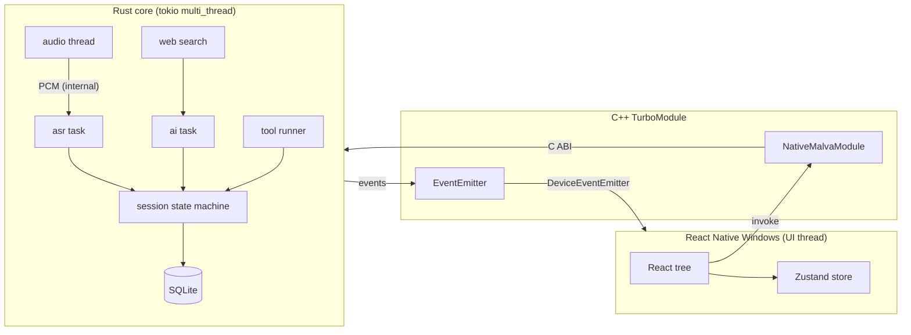
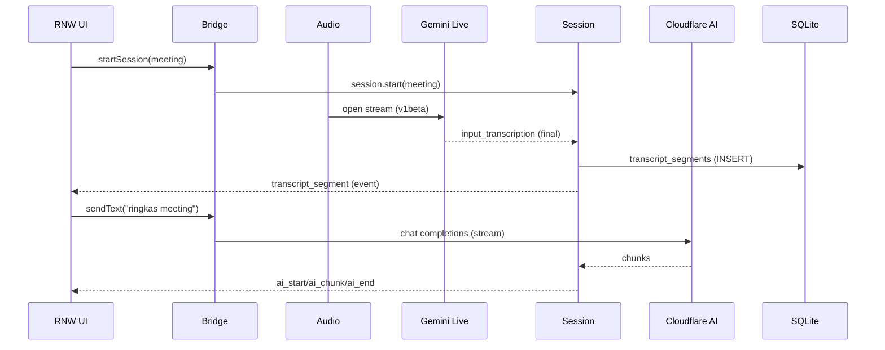
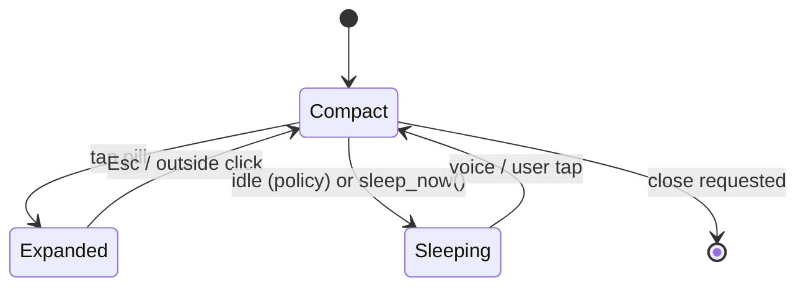

# Malva — Native Windows Architecture Blueprint

> **Document:** `BLUEPRINT-NATIVE.md` (architecture & migration blueprint)
> **Companion to:** `BLUEPRINT.md` (product blueprint, unchanged) and `HANDOFF.md` (implementation handoff)
> **Date:** 2026-11-11
> **Status:** Research & design — implementation has NOT started. The existing Python/pywebview application must remain functional and untouched.
> **Audience:** Humans and AI coding agents.

---

## 1. Executive Summary

Malva today is a **Python 3.10+ application** (`app.py`, `malva/`) that renders its UI through **pywebview + WebView2** as a frameless, always-on-top "floating pill". Audio is captured with PyAudio/PyAudioWPatch, transcribed by the **Gemini Live** API, answered by **Cloudflare Workers AI**, and stored in **SQLite**. Desktop automation (~44 LLM tools) drives Windows via `ctypes`/Win32, `pywinauto` (UI Automation), and DuckDuckGo HTML search.

This blueprint defines the migration to a **genuinely native** Windows application:

- **UI:** React Native Windows (RNW) + TypeScript, Fabric (New Architecture only), dark-first design system.
- **Bridge:** C++ TurboModules → Rust via a **C ABI**, JSI only where profiling proves it necessary.
- **Core:** One Rust workspace owning audio, ASR, AI, web search, desktop automation, session, storage, privacy, and system lifecycle.
- **Native:** Direct Win32/DWM APIs (via `windows-rs` and a thin C++ layer for the frameless transparent window).
- **Storage:** SQLite via `rusqlite` (bundled) with explicit migrations.
- **No** WebView/WebView2 renderer, no Tauri, no Electron, no Python in the runtime.

**Why this direction is appropriate**

- The current architecture's weakest points are exactly what the target stack fixes: WebView2's per-window overhead and DPI quirks, Python's GIL and startup cost, and ad-hoc threading (invisible to type/ownership checking).
- Rust + WASAPI loopback + CPAL is the same audio path the app already relies on, but with compile-time safety and no interpreter boundary between capture and transport.
- React Native Windows gives a modern, maintainable UI with a documented path to Win32/C++ customisations (`ReactNativeWin32App`, `hideTitleBar`/`hideBorder` on `Modal`), which the pill needs.

**Why it is NOT a guaranteed win (see §23)**

- RNW cannot make a borderless, transparent, topmost window without a Win32/C++ native module; this is real work, not a flag.
- The Gemini Live API has **no official Rust SDK**. A hand-written WebSocket client must be treated as a protocol implementation to be tested against the live API, not assumed correct.
- `pywinauto`'s richness (~1966 lines in `browser.py`) has no 1:1 Rust equivalent; `windows::UI::UIAutomation` or the `uiautomation` crate covers the primitives, but the *behaviour* must be re-implemented and re-verified.

---

## 2. Existing Architecture Audit (verified against source, 2026-11-11)

All claims below were checked against the working tree (131 tests passing). The repository contains the Python app, tests, and docs only — there is **no** Rust/C++ code yet.

### 2.1 Entry points

| Entry | File | Notes |
|---|---|---|
| App entry | `app.py` | Loads `.env`, sets `WEBVIEW2_ADDITIONAL_BROWSER_ARGUMENTS`, configures diagnostics, creates DB, starts pywebview. |
| Package init | `malva/__init__.py`, `malva/*/__init__.py` | Re-exports only. |
| Tests | `tests/test_*.py` (8 files, **131 tests**) | No network, no mic, no real Windows APIs (fakes for PyAudio, SDK, httpx). |

### 2.2 UI implementation

- Single inline HTML document: `malva/ui/html.py` (`PILL_HTML`), injected into `webview.create_window(...)`.
- Layout: compact pill (440×62) ↔ expanded panel (440×450) ↔ sleep capsule (175×46). All styling/JS lives in that one Python string — no build step, no components, no design tokens, no state store.
- Data flow: `app.py` dispatches `window.<fn>(jsonArgs)`; the page re-renders by calling back `pywebview` JS-API methods (`MalvaAPI`).
- DWM styling applied post-create in `MalvaApp._apply_native_styling`: `DwmSetWindowAttribute(DWMWA_WINDOW_CORNER_PREFERENCE=33, DWMWCP_ROUND)` and `DWMWA_USE_IMMERSIVE_DARK_MODE=20`.
- `get_hwnd()` uses `self.window.native.Handle.ToInt64()`, falling back to `FindWindowW(None, "Malva")`.
- Frameless window: `frameless=True, on_top=True, easy_drag=False` (custom drag via JS), `transparent=False`, `background_color="#000000"`.

### 2.3 Audio capture and processing

`malva/audio/capture.py` (`AudioEngine`, `AudioTrack`):

- `TrackSource.MICROPHONE` (PyAudio) and `TrackSource.SYSTEM_AUDIO` (PyAudioWPatch WASAPI loopback). Never mixed.
- If loopback is unavailable, `start()` raises `AudioDeviceError(ERR_LOOPBACK_UNAVAILABLE)`. No fallback to default mic.
- Device enumeration/fallback logic in `devices.py`; band energies for UI in `analysis.py` (`SpectrumAnalyzer`).
- 1024-frame chunks; downmix to mono; resample to 16 kHz with `scipy.signal.resample_poly` when device rate ≠ 16 kHz.
- Levels throttled to 25 Hz; speech-activity (RMS > 45) reported ≤ 1 Hz to keep the session awake.
- Pause drains/resets, read errors tolerated up to 25 before `ERR_DEVICE_LOST`.

### 2.4 Gemini Live transcription

`malva/asr/`:

- `gemini_live.py` — `GeminiLiveStream`: one asyncio loop per source; `google.genai` client **pinned to `v1beta`** (`LIVE_API_VERSION`), because `google-genai` 3.x defaults to `v1`, where `BidiGenerateContent` is not served and every Live call fails with HTTP 404. Model: `gemini-3.5-transcribe-live`, `response_modalities=["TEXT"]`, `input_audio_transcription` with optional `language_codes`.
- Bounded queue (300 chunks ≈ 19 s); oldest dropped on overflow (`dropped_chunks` counted).
- 10-min API session limit handled by reconnecting at 9 min (`SESSION_ROTATE_SECONDS`).
- `interim_input_transcription` → `on_partial` (displayed), `input_transcription` → `on_final` (persisted). Permanent rejections (400/401/403/404) are surfaced once and never retried.
- `service.py` (`ASRService`) gates on `GEMINI_API_KEY` and `CLOUD_ENABLED`.

### 2.5 AI orchestration

`malva/ai/orchestrator.py` (`AIOrchestrator`):

- Cloud path: **Cloudflare Workers AI** `@cf/meta/llama-3.3-70b-instruct-fp8-fast` via the OpenAI-compatible endpoint `…/accounts/{id}/ai/v1/chat/completions` (streaming SSE, `data:` deltas), history-capped conversation context, mode-specific system prompts (assistant/meeting/interview_practice/interview_notes/voice_input), injected realtime web context (`malva/desktop/tools/web.py`), tool-call parsing (`{"tool":…,"args":{…}}`).
- Fail-closed when `CLOUD_ENABLED=false` or credentials missing; streaming with non-streaming fallback.

### 2.6 Web search

`malva/desktop/tools/web_backend.py` + `web.py`: DuckDuckGo HTML search (no API key) + direct HTML fetch, always gated by the cloud policy; 10-minute cache; `needs_realtime()` regex to decide when to inject context. `web.py` formats results for the LLM and validates URLs (http/https only, private hosts blocked).

### 2.7 Desktop automation

`malva/desktop/`:

- `gateway.py` — session-bound approval policy (`requires_approval`): delete-ish tools only.
- `tools/registry.py` — **44 tools** in a manifest used for the LLM prompt.
- `tools/runner.py` — validation/dispatch to real implementations; blocks `type_text` into terminals; VS Code strict mode opt-in; allow-list for `run_command`.
- Implementations: `keyboard.py` (SendInput via ctypes), `desktop.py` (~3167 lines; window enumeration, app launching, focus, browser window tracking), `browser.py` (**1966 lines**; UI-Automation clicks/fills/search/play on YouTube/Tokopedia/etc., tab control), `shell.py`, `interaction.py` (pywinauto), `observation.py` (window/controls inspection), `verification.py` (window/file/process verification), `safety.py` (destructive-text blocking).
- `desktop.py` builds a dynamic app map by scanning Start Menu/registry (`apps_map.json` cache).

### 2.8 Storage

`malva/storage/db.py`: raw `sqlite3` (no ORM). Tables: `sessions, audio_tracks, transcript_segments, speakers, meeting_notes, decisions, action_items, interview_reports, app_settings, tool_audit_logs` (+6 indexes). **No migration framework, no schema versioning** (`user_version` unused); schema is created with `CREATE TABLE IF NOT EXISTS` at startup. FTS not used. Settings key/value via `app_settings`.

### 2.9 Sessions, privacy, policy

- `malva/shell/session.py` (`MalvaSession`): mode state machine (IDLE/LISTENING/PROCESSING/PAUSED/SLEEPING/ERROR); emits 25 canonical events (`EVENT_TYPES`) consumed by `app.py`; voice-approval of destructive actions; cross-meeting decision memory (`find_decisions_across_sessions`).
- `malva/shell/policy.py` — auto-sleep/focus rules, `voice_decision()` (full-phrase only).
- `malva/privacy/manager.py` — single `allows_cloud()` gate (`CLOUD_ENABLED`); `SetWindowDisplayAffinity(WDA_EXCLUDEFROMCAPTURE)` hidden mode (best effort, not a guarantee).
- `malva/diagnostics.py` — rotating file logs at `%LOCALAPPDATA%\Malva\logs`, crash handler.

### 2.10 Dependencies & environment

`requirements.txt`: pyaudio 0.2.14, pyaudiowpatch 0.2.12.9, sounddevice 0.5.2, numpy 2.2.6, scipy 1.16.1, google-genai (unpinned), httpx 0.27.0, python-dotenv 1.0.1, psutil 7.2.2, pywinauto 0.6.9, pywebview 6.2.1. `.env`: CLOUD_ENABLED, GEMINI_API_KEY, GEMINI_ASR_MODEL, CLOUDFLARE_ACCOUNT_ID/API_TOKEN/MODEL, SLEEP_AFTER_SECONDS, TOOLS_ENABLED, WEB_*. There is no CI, no packaging, no installer, no update mechanism.

### 2.11 Architectural problems (verified)

1. UI is an unmaintainable 3-context string (Python→HTML/CSS/JS) with no type safety, no components, no testable state layer.
2. Two rendering/execution runtimes (Python + WebView2 JS) with a fragile ad-hoc event bridge; every UI update is a string evaluated in the page.
3. `browser.py`/`desktop.py` mix automation, detection heuristics, and I/O in 2000–3000-line modules — no interfaces, hard to port "as is", and impossible to verify exhaustively.
4. SQLite without migrations/versioning — any schema change is a breaking change for existing `malva.db`.
5. Hidden coupling: UI asks Python for everything; there is no command/event boundary that a native app could reuse.
6. Tests are good at contract level but never touch Windows behavior — all Windows-specific claims are unverified.

---

## 3. Current Feature Inventory (migration parity matrix)

Legend: **Must** = must survive migration · **Redesign** = keep feature, rewrite implementation · **Reuse** = reusable as-is · **Drop?** = candidate to drop/rethink.

| # | Feature | Current | Verdict | Target |
|---|---|---|---|---|
| F1 | Floating pill (frameless, topmost) | pywebview frameless `WebView2` | Redesign | RNW + Win32/C++ transparent window |
| F2 | Expanded panel / sleep capsule | window resize + HTML states | Redesign | Two-window or sized React tree + Win32 `SetWindowPos` |
| F3 | Assistant chat (streaming) | SSE → JS `appendAnswer` | Redesign | Rust `reqwest` SSE → event → RN text state |
| F4 | Live partial/final transcript | GeminiLiveStream (v1beta) | Reuse logic, Redesign | Rust `gemini_live` module + event bus |
| F5 | Meeting mode (system audio only) | loopback + summary/action items | Must | Rust audio engine + session engine |
| F6 | Interview practice (mic) | AI interviewer, feedback, report | Must | Rust session + interview engine port |
| F7 | Interview notes | Mic; Q/A extraction; report | Must | Rust session + interview engine port |
| F8 | Voice input (mic only) | Enforced in `AudioEngine` | Must | Same invariant, enforced by Rust type |
| F9 | Assistant mode (mic + system audio) | Default mode | Must | Same |
| F10 | Auto-sleep after idle | `policy.should_auto_sleep`, 60 s default | Must | Rust `policy` module (ported + tested) |
| F11 | Focus mode | Flag persisted; suppresses sleep | Must | Rust setting + UI toggle |
| F12 | Pause/resume capture | Drains audio, resets bars | Must | Rust engine pause API |
| F13 | Audio level bars (real FFT) | scipy/numpy → 25 Hz events | Redesign | Rust `rustfft`; 15–25 Hz events |
| F14 | Speech activity → keep awake | RMS > 45, ≤ 1 Hz | Reuse (port) | Rust RMS |
| F15 | Cross-session decision memory | SQL `find_decisions_across_sessions` | Must | Rust storage query |
| F16 | Meeting report | LLM + local DB | Must | Rust + Cloudflare |
| F17 | Interview practice report | LLM + local DB | Must | Rust + Cloudflare |
| F18 | Desktop tool runner (44 tools) | Python dispatch | Redesign | Rust `tool_runner` + Win32/UIA |
| F19 | Destructive-action approval | Delete-only, voice or click | Must | Same policy, Rust types |
| F20 | Hidden Mode | `SetWindowDisplayAffinity` best effort | Reuse (port) | windows-rs; same honest-limitation UI |
| F21 | Cloud gate `CLOUD_ENABLED` | Every cloud path checks it | Must | Rust `PrivacyGate` (single source) |
| F22 | DuckDuckGo search + fetch | HTML scrape | Must | Rust `reqwest` + HTML parse |
| F23 | Realtime context injection | regex + web search | Must | Rust module |
| F24 | Transcript persistence + full-text | `transcript_segments` raw SQL | Redesign | SQLite FTS5 (additive, migrated) |
| F25 | Session history + settings UI | `app_settings` | Must | Rust storage + Settings screen |
| F26 | Sleeper wake on voice | speech activity | Must | Rust |
| F27 | Tool audit log | `tool_audit_logs` | Must | Rust storage + UI view |
| F28 | Diagnostics/logging | file logs | Redesign | `tracing` + JSONL |
| F29 | Windows app map (dynamic) | Start Menu/registry scan, `apps_map.json` | Redesign | Rust equivalent (registry + Start Menu scan) |
| F30 | Crash reporting | crash log, manual | Redesign | Structured crash log + optional minidump |

---

## 4. Target Architecture

Three planes, one process:

- **Presentation plane** — React Native Windows (Fabric), TypeScript.
- **Bridge plane** — C++ TurboModule(s) exposing a **Rust staticlib** behind a C ABI. Events flow Rust→TS over a native event emitter.
- **Core plane** — Rust workspace (`malva-core`): audio, asr, ai, web, tools, session, storage, privacy, system.

```
┌────────────────────────────────────────────────────────────────┐
│  Presentation Plane (React Native Windows 0.85, Fabric, TS)    │
│  Pill · Expanded panel · Meeting · Interview · Settings · etc. │
│  Zustand stores · React Navigation · design tokens             │
└───────────────▲───────────────────────────▲─────────────────────┘
                │  C++ TurboModule (REACT_MODULE)                 │ events
┌───────────────┴───────────────────────────┴─────────────────────┐
│  Bridge Plane (C++, static .lib from malva-core)                │
│  REACT_SYNC_METHOD for control · native event emitter for events│
└───────────────▲───────────────────────────▲─────────────────────┘
                │  C ABI (extern "C")       │  callback/queue
┌───────────────┴───────────────────────────┴─────────────────────┐
│  Core Plane (Rust workspace · no GC · single process)           │
│  audio · asr · ai · web · tools · session · storage · privacy    │
│  system · policy · diagnostics                                   │
└───────────────▲───────────────────────────▲─────────────────────┘
                │ Win32 / WASAPI / DWM / registry / UIA            │ WS/HTTPS
          Windows APIs                                   Gemini Live · Cloudflare · DuckDuckGo
```

**Hard boundaries**

- Raw PCM never crosses the bridge. Rust owns capture → resample → (optional) FFT → hand to ASR. TS receives only events (`transcript_*`, `audio_levels`, …) plus the exact bytes of a user-triggered export.
- Every UI action is a command with a correlation ID, echoed back as an event, so the UI never has to guess whether the core accepted it.
- The bridge owns all memory crossing it. Rust allocations are returned through caller-provided buffers or `*mut c_char` freed by a paired `malva_free`.
- No blocking call on the UI thread: every REACT_METHOD is async, except microseconds-scale getters (`status`).

## 5. Architecture Diagrams

### 5.1 Process & thread model



### 5.2 Session data flow



### 5.3 Window states



---

## 6. Technology Stack

| Layer | Choice | Version (verified 2026-11) | Notes |
|---|---|---|---|
| Runtime UI | React Native Windows (Fabric only) | **0.85.0** (RN 0.85.3) | Paper removed in 0.82; New Architecture mandatory. |
| UI language | TypeScript | 5.x | strict mode on. |
| State | Zustand | 5.x | Pure JS, Windows-compatible. |
| Navigation | React Navigation (native-stack) | 7.x | Confirmed in RNW community/Gallery. Expo Router: [UNVERIFIED on RNW 0.85]. |
| Bridge | C++ TurboModule + staticlib C ABI | RNW 0.85 codegen | REACT_MODULE/REACT_METHOD; JSI raw access experimental — avoid. |
| Core | Rust | **1.99.1** stable (Oct 2026) | `x86_64-pc-windows-msvc` Tier 1. |
| Async | tokio 1.x | | All I/O in core; single runtime. |
| Audio | cpal 0.16 + windows-rs (WASAPI loopback) | CPAL MSRV 1.85, Win10+ | Loopback = `build_input_stream` on an **output** device (`AUDCLNT_STREAMFLAGS_LOOPBACK`, shared mode only). |
| FFT | rustfft | | For band energies (parity with current levels UI). |
| WebSocket | tokio-tungstenite | | Gemini Live; no official Rust SDK exists. |
| HTTP | reqwest 0.12 (rustls) | | Cloudflare, web search/fetch. |
| SQLite | rusqlite 0.32 (bundled) + rusqlite_migration 2.x | | Synchronous, single-writer OK for desktop load. |
| Windows | windows crate 0.60 | | DWM/Win32/UIA bindings. |
| UI Automation | `uiautomation` 0.25 (ergonomics) or raw `windows::UI::UIAutomation` | | Ergonomics closer to pywinauto; raw crate has no external dep. |
| Logging | tracing + tracing-subscriber (JSONL) | | Structured logs, no PII. |
| Icons/anim | Reanimated (RNW fork) or plain `Animated` | [UNVERIFIED: Reanimated Windows parity] | Fall back to `Animated`/`react-native-reanimated` Windows support needs verification before adoption (§22). |
| Credential store | Windows Credential Manager (via `windows` crate / `keyring`) | | Gemini/Cloudflare keys. Not `.env` in release builds. |
| Packaging | MSIX (WinAppSDK) | | Installs/uninstalls cleanly; startup task via MSIX manifest. |

**Explicitly excluded:** Electron, Tauri, WebView2 renderer, Python runtime, local LLM.

## 7. Frontend Architecture (React Native Windows)

### 7.1 Project shape

```
apps/desktop/
├─ src/
│  ├─ components/        # atoms & molecules (see design system §16)
│  ├─ features/          # assistant | meeting | interview | settings | history
│  ├─ screens/           # Pill, Expanded, Meeting, Interview, Settings, History
│  ├─ hooks/             # useSession, useASRStatus, useTranscript, useFocusSleep
│  ├─ services/bridge/   # typed wrappers around NativeMalvaModule
│  ├─ stores/            # Zustand: sessionStore, settingsStore, asrStore
│  └─ theme/             # tokens.ts (colors, spacing, radius, motion)
├─ windows/
│  ├─ react_native_windows1.props
│  └─ native/bridge/     # C++ TurboModule sources + .lib
└─ __tests__/            # Jest + @testing-library/react-native
```

### 7.2 State management conventions

- **One Zustand store per concern** — `sessionStore` (mode, state, sources, mic/system levels), `transcriptStore` (segments, partial), `settingsStore` (focus, sleep_after, hidden mode, language), `historyStore`.
- Stores subscribe to the bridge event emitter once (`App.tsx` boot). Components select narrow slices (`select` selectors, shallow equality) to avoid re-render storms.
- **Never** store transcript/partials in React state at row granularity for long sessions; keep segments in a capped external structure and expose derived counts.
- Every store mutation that originates from the core echoes `correlationId` so optimistic UI rolls back on failure (rare; core is source of truth).

### 7.3 Rendering rules

- `React.memo` on rows/cards; virtualize long lists (`FlatList` windowed).
- Levels: at most 25 Hz updates; bars rendered from a single `Animated.Value` ref, not state churn.
- Partial transcript: replace one `Text` node, not re-render the tree.

### 7.4 The eight UI areas (with component hierarchy)

**1. Floating Pill** — `PillScreen` (Compact): mic/system level bars, status dot, mode chip, expand affordance. Emits `expand` → resize window to Medium. Hide taskbar entry while compact; show on expand.

**2. Expanded Assistant** — `AssistantScreen`: header (mode, focus toggle, sleep button) · transcript pane · chat pane · quick action bar (meeting/interview/assistant switch).

**3. Chat** — `ChatPane`: `MessageList` (memoized `MessageRow`) · `Composer` (multiline `TextInput`, Enter to send, Shift+Enter newline) · `ToolActionCard` for pending/approved actions.

**4. Live Transcript** — `TranscriptPane`: segment list with source badge (Mic/System), partial row pinned at bottom, scroll-to-latest.

**5. Meeting Workspace** — `MeetingScreen`: system-audio-only consent banner · live transcript · decisions/action-items rail · "Finalise report" button (calls core).

**6. Interview Workspace** — `InterviewScreen`: two tabs: `Practice` (question card → answer → feedback → next) and `Notes` (Q/A log) · `ReportSheet` on finish.

**7. Settings** — `SettingsScreen`: cloud gate status (read-only) · ASR model/language · sleep-after · focus default · hidden mode · logs folder · DB size/location · "clear local data" (with confirmation).

**8. Session History** — `HistoryScreen`: list of sessions (mode, date, duration, decision/action counts) · detail view · export Markdown · delete (destructive → confirm).

### 7.5 Multiple native windows

Two windows are appropriate: **Pill** (always on top, tiny) and **Main/Workspace** (normal window). A single 0.85 RNW Fabric tree with conditional full-screen vs pill layout can also be used, but the native two-window split maps cleanly onto Win32 `CreateWindowEx` constants and react-native-windows' multi-app-hosting story. Decide in Phase 1 (§20): default recommendation is **one app host, one topmost pill window + one normal window**.

## 8. C++ / Rust Bridge Design

### 8.1 Integration strategies evaluated

| Strategy | Pros | Cons | Use |
|---|---|---|---|
| **C ABI + Rust staticlib** | Simple, stable ABI, easy to link, JSON/FFI-friendly | Manual memory rules; JSON parse cost | Control commands, getters, events |
| **C++ TurboModules (REACT_MODULE)** | Codegen types, first-class RNW integration | Verbose; every module needs C++ impl | The single `NativeMalvaModule` |
| **JSI** | Fastest path | Marked experimental in RNW; raw lifetimes | Avoid v1; revisit only with profiler data |
| **Event emitter (DeviceEventEmitter)** | Natural for streams | Ordering needs seq/correlationId | All async core→UI traffic |
| **Named pipes/gRPC sidecar** | Process isolation | Extra process, packaging, slower | Rejected for core (MCP is separate by design) |
| **WASM/WebView** | — | Excluded by requirements | Rejected |

**Recommendation:** TS → codegen C++ TurboModule (`NativeMalvaModule`) → `extern "C"` functions in `malva-core`, with events emitted via `RCTDeviceEventEmitter` (RNW equivalent) with `{seq, correlationId, type, payload}`. All payloads crossing the boundary are **JSON strings** except (a) enum constants as integers, (b) nothing else. This is deliberately not JSI/jsi::Value for v1.

### 8.2 C ABI surface (illustrative, contract-frozen in codegen)

```rust
// control (sync, fast)
u32  malva_status(void) -> bitmask
u32  malva_session_start(mode: *const c_char) -> err
u32  malva_session_stop(void) -> err
u32  malva_session_pause(void) -> err
u32  malva_session_resume(void) -> err
u32  malva_sleep(bool confirmed) -> err
u32  malva_wake(void) -> err

// async command pattern: result delivered as event, call returns correlationId
u32  malva_ai_ask(text: *const c_char, correlation_id: *mut u64) -> err
u32  malva_asr_set_language(lang: *const c_char) -> err

// memory discipline
void malva_free_string(s: *mut c_char)
```

Rules:
- Strings are UTF-8, caller frees returned `char*` via `malva_free_string`.
- No Rust panic crosses FFI (`catch_unwind`/`abort` policy documented).
- All long-running work returns immediately; completion arrives as `ai_chunk`/`*_end` events.
- Error codes map to a documented enum (`MALVA_OK`, `MALVA_NO_KEY`, `MALVA_CLOUD_DISABLED`, `MALVA_BUSY`, …) mirrored in TS as a const map with a typed `MalvaError` union.

### 8.3 Event contract (single registry)

One TS module `src/services/bridge/events.ts` lists every event type exactly once (mirroring a Rust enum, checked by a build-time codegen step). The 25 current `EVENT_TYPES` are kept byte-for-byte where sensible so the UI port is a rename, not a redesign: `session_started`, `session_ended`, `source_state`, `capture_error`, `state_change`, `transcript_segment`, `transcript_partial`, `audio_levels`, `ai_start|chunk|end|error`, `action_proposed|action_result`, `voice_input_text`, `focus_mode`, `sleep_mode`, `interview_*`, `meeting_report`, `asr_error`, `report_error`, `notice`. Test in Jest + Rust to keep them in sync.

### 8.4 Threading

- RNW UI thread → never blocks.
- TurboModule calls run on a bridge thread and immediately hand work to tokio.
- Rust emits events with a background thread; the C++ side re-enters the JS thread via `CallFunctionOnJSThread`/`RCTDeviceEventEmitter`.

### 8.5 Error & ownership discipline

- `Result<_, MalvaError>` in Rust → `u32` code + detail event.
- Detail payload (human-readable, Indonesian) travels as event, not as FFI string with lifetime traps.
- UI crash surfaces → `error.tsx` boundary + `diagnostics` upload (manual, local-only by default).

---

## 9. Rust Core Module Design

Workspace: `native/malva-core` (`Cargo.toml`) with member crates; `crate-type = ["staticlib", "rlib"]` so Rust tests and the C++ link step both work.

```
native/malva-core/
├─ Cargo.toml            # workspace root
├─ crates/
│  ├─ malva-audio        # capture, resample, fft, levels, speech-RMS
│  ├─ malva-asr          # Gemini Live WebSocket client + retry/rotate
│  ├─ malva-ai           # Cloudflare Workers AI (OpenAI-compat) + SSE + tools parse
│  ├─ malva-web          # DuckDuckGo search + fetch + cache + needs_realtime
│  ├─ malva-tools        # registry (44 tools) + runner + safety + approval policy
│  ├─ malva-session      # state machine, events, mode engines (meeting/interview)
│  ├─ malva-storage      # rusqlite + rusqlite_migration + models + repos
│  ├─ malva-privacy      # gate (CLOUD_ENABLED), Credential Manager, hidden mode
│  ├─ malva-system       # lifecycle, tray, hotkeys, app map, diagnostics
│  └─ malva-ffi          # extern "C" surface, staticlib output
└─ migrations/            # 0001_init.sql …
```

### 9.1 malva-audio

- `AudioEngine`: owns `Track` per source (`mic`, `system`). `start()` opens stream synchronously and only then reports `active` (mirrors current fail-fast semantics). WASAPI loopback via CPAL when available; CPAL's WASAPI backend auto-enables loopback when building an **input stream on an output device**. Enumeration includes device name, rate, channels, `is_loopback` hint.
- Resample → 16 kHz mono (`s16` PCM) via `rubato` (streaming resampler; replaces scipy). Same int16 RMS > 45 speech heuristic (keep-awake); same 25 Hz capped levels via `rustfft`.
- Pause = stop pushing into ASR queue but keep draining (no stale buffers). Device lost → `ReadError` after N (e.g. 25) consecutive errors → typed event.

### 9.2 malva-asr

- `GeminiLive` client: `wss://generativelanguage.googleapis.com/ws/google.ai.generativelanguage.v1beta.GenerativeService.BidiGenerateContent?key=…` (verified endpoint format; `v1beta` mandatory — see audit §2.4).
- Messages: `setup` (`response_modalities:["TEXT"]`, `input_audio_transcription` with optional `language_codes`), `realtimeInput` (`audio/pcm;rate=16000` chunks, base64), `server_content.interim_input_transcription` → partial; `server_content.input_transcription` → final; `goAway`/`setupComplete`/`toolCall` handled per schema.
- Reconnect after ~9 min (API limit 10); bounded in-flight queue (cap ~300 chunks, drop-oldest, count drops); permanent 4xx = emit once + stop retrying (parity with current behavior).
- No official Rust SDK — **treat as a protocol crate**: golden-message unit tests (recorded frames) + one live smoke test gated behind `GEMINI_SMOKE=1`.
- API key from Credential Manager (release) or `GEMINI_API_KEY` env (dev).

### 9.3 malva-ai

- `Provider` trait (`CloudflareWorkersAI` now; trait prevents tight coupling — swap via config `ai_provider`, future providers possible).
- Streaming SSE from `https://api.cloudflare.com/client/v4/accounts/{id}/ai/v1/chat/completions` (v1 compatible shape, model e.g. `@cf/meta/llama-3.3-70b-instruct-fp8-fast`); `data:` lines → `ai_chunk` events; `[DONE]` terminates; non-streaming fallback on stream failure (parity with current).
- Conversation context capped (`_MAX_HISTORY`), mode prompts ported verbatim to Rust `const` strings, `needs_realtime` injected by web module, tool-call JSON extraction (`{"tool","args"}`) with tolerant parsing.
- Cancellation: `CancellationToken` per request; `malva_ai_ask` returns correlation id; `cancel(correlation_id)` sets token.

### 9.4 malva-web

- DuckDuckGo HTML (`https://html.duckduckgo.com/html/`) — no API key; private host block; URL validation; 10-min in-memory cache; `needs_realtime()` regex ported verbatim.

### 9.5 malva-tools

- `Registry` const/table (port of the 44 tools with args + descriptions) — single source for prompt and validation.
- `Runner`: typed parse (`ToolArgs`), safety gates (`type_text` blocked in terminals, VS Code strict mode, `run_command` allowlist), dispatch to `windows`-rs implementations.
- `ApprovalPolicy`: delete-pattern match (port `safety.py`) — only destructive tools need approval; spoken approval via `voice_decision()` full-phrase matching (port verbatim + tests).
- Audit every call to `tool_audit_logs`.

### 9.6 malva-session

- Same modes: assistant, meeting, interview_practice, interview_notes, voice_input — with the same default source rules (voice_input rejects system audio; meeting rejects mic by default).
- Event bus (`tokio::sync::broadcast`) — all modules emit; FFI layer relays to UI; `transcript_segments` persisted transactionally per final segment.
- `MalvaSession` state machine identical states; sleep policy ported verbatim from `policy.py`; cross-meeting memory query implemented in storage.

### 9.7 malva-storage

- `rusqlite` bundled + `rusqlite_migration` (user_version) — deterministic, offline, no .NET dependency.
- Migration `0001_init.sql` mirrors the current schema **plus** `schema_version` bookkeeping; `0002_fts.sql` adds `transcript_segments_fts` (FTS5) with insert triggers; additive only — existing `malva.db` is upgraded in place (backup first: `malva.db.bak-<timestamp>`).

### 9.8 malva-privacy

- `PrivacyGate::allows_cloud()` — same semantics as `allows_cloud` in current code (`CLOUD_ENABLED` default true; explicit false disables). Single source of truth for ASR/AI/web.
- Credentials in **Windows Credential Manager** (release) / env (dev).
- `SetWindowDisplayAffinity(WDA_EXCLUDEFROMCAPTURE)` hidden mode with the same honest limitation text in UI; requires `WS_EX_LAYERED`.

### 9.9 malva-system

- Startup: MSIX StartupTask (user opt-in) — no registry hack. App restart policy.
- Tray icon (Win32 `Shell_NotifyIcon`) when compact; single instance (named mutex), DPI awareness via manifest (PerMonitorV2).
- Global hotkeys (`RegisterHotKey`) for push-to-talk / wake / toggle focus — optional, user-configured.
- Power events (`WM_POWERBROADCAST`) → sleep/pause ASR; shutdown → graceful flush + `.bak` before migrations.
- Diagnostics: file log (`%LOCALAPPDATA%\Malva\logs\malva.log`), levels from env, JSONL lines, no transcript PII.

### 9.10 malva-ffi

- All `#[no_mangle] pub extern "C"` functions: `#[repr(C)]` error enum, UTF-8 `CString`, `catch_unwind` at every entry, opaque `*mut CallHandle` for async commands so the UI can cancel.
- One `malva_core_init(app_data_dir, log_dir)` returning a handle stored in the C++ module.

---

## 10. Native Windows Window Architecture

**Requirement recap:** borderless, transparent (best effort), always-on-top floating pill; compact ↔ expanded ↔ sleeping sizes; draggable by its body; DPI-aware; multi-monitor-safe; taskbar/tray behavior; hidden mode; focus/sleep awareness; single instance; global hotkeys.

| Concern | RNW 0.85 native support | Verdict / needed work |
|---|---|---|
| Fabric rendering | Supported (mandatory since 0.82) | Use. |
| Frameless window | Not a prop on the main app host | Win32/C++ host call `CreateWindowEx(WS_POPUP \| WS_EX_TOOLWINDOW \| WS_EX_LAYERED, …)` or style the `ReactNativeWin32App`'s HWND post-create. |
| Always-on-top | `SetWindowPos(HWND_TOPMOST, …)` | Native module; also `WS_EX_TOPMOST`. |
| Transparent background | DWM `DwmExtendFrameIntoClientArea({-1,-1,-1,-1})` | Requires extending glass + layered window; **DWM dark/rounded corners** via `DwmSetWindowAttribute(33/20)` like current app. |
| Drag anywhere | No native prop | `SendMessage(WM_NCHITTEST)` → `HTCAPTION` trick, or `GetCursorPos`+`SetWindowPos` from a transparent drag region; JS pointer events forwarded to native. |
| Resize compact↔expanded↔sleep | `SetWindowPos`/`SetWindowRgn` | Native module with three presets; animate via `Animated` on the React side + `SetWindowPos` on native side. |
| Modal without title bar | `Modal` `hideBorder`/`hideTitleBar` (0.85) | Usable for Settings-like popups inside expanded host. |
| Taskbar visibility | `WS_EX_TOOLWINDOW` hides from taskbar & Alt-Tab | Pill hidden from taskbar; tray icon instead. |
| Multi-monitor | `MonitorFromWindow`/`SetWindowPos` clamp to work area | Native; clamp initial position to primary work area; remember last position per-monitor (multi-DPI). |
| DPI scaling | Per-Monitor v2 manifest | RNW default is PerMonitorV2-this works; verify `SetProcessDpiAwarenessContext`. Win10 1903+ handles mixed-DPI fine. |
| Hidden Mode | `SetWindowDisplayAffinity(WDA_EXCLUDEFROMCAPTURE)` | Needs layered; not a guarantee — UI must say so. |
| Sleep capsule | same window, smaller HWND | One host, three layouts = simplest. |
| Global hotkeys | `RegisterHotKey` + window proc | Handle `WM_HOTKEY` in native module → forward to core → event. |

**Recommended v1:** one Win32 host window created by the C++ side (not the RNW default window), hosting the RNW Fabric root view. React handles layout; native handles HWND/WS_POPUP/WS_EX_*; DWM handles transparency/rounded corners. **Transparent background is best-effort:** if `DwmExtendFrameIntoClientArea` fails, fall back to near-black opaque (`#050505`) rather than refusing to start.

**Limitations (explicit):**

1. `WS_EX_LAYERED` + `SetWindowDisplayAffinity(EXCLUDE_FROM_CAPTURE)` + `UpdateLayeredWindow` cannot all be combined (Win32 rule) — pick layered-via-DWM only; do not also call `UpdateLayeredWindow`.
2. Topmost does not mean "above fullscreen exclusive games" (not a goal).
3. Transparent click-through (`WS_EX_TRANSPARENT`) is incompatible with an interactive pill — never set both.
4. Multi-monitor DPI changes mid-session can make the pill invisible off-screen → clamp on `WM_DPICHANGED`.
5. RNW 0.85 `Modal` borderless is for modal popups, not the main window.

## 11. Audio Architecture

```
Mic ──► WASAPI input ──► [downmix mono] ──► resample→16k (rubato) ──┐
                                                                     ├─► PCM rings (bounded 300×) ─► ASR
System ──► WASAPI loopback (output device as input) ──► same path ───┘

Both tracks also feed: rustfft band energies (25 Hz) + RMS → levels/speech events
```

Design rules:

- **Never mix tracks.** Each track has its own `Track`, its own ASR session, its own queue. Meeting = system-only; interview/voice-input = mic-only; assistant = both, separately tagged (`source` on every event).
- **Bounded everywhere:** 300× audio chunks in flight per track (drop-oldest + `dropped_chunks` counter); no unbounded channel anywhere in core.
- Levels: `rustfft` on 1024-sample frames → 8 log bands; emit `audio_levels{source, levels[8]}` at ≤25 Hz.
- Speech activity: `rms > 45.0` (int16 scale), ≤1 Hz, only to keep the session awake and to wake from sleep.
- Resampling: `rubato` streaming resampler (chunk-in/chunk-out), replacing `scipy.signal.resample_poly`. 16 kHz/16-bit/mono output always.
- Pause: stop feeding ASR; keep device running; reset FFT state; buffers still drained so resume has no stale audio.
- Disconnect: consecutive read errors ≥ 25 → `capture_error` + track `error` state → UI banner; do not silently retry forever.
- Device selection: optional `device_index` in start command; default = system default (mic) / default rendering endpoint (loopback).

Testing: unit tests for resample/RMS/levels with synthetic buffers; device tests behind `#[ignore]` for real hardware; CPAL loopback verified on Windows 10/11.

## 12. AI and ASR Architecture

### 12.1 ASR (Gemini Live)

- Endpoint (verified): `wss://generativelanguage.googleapis.com/ws/google.ai.generativelanguage.v1beta.GenerativeService.BidiGenerateContent?key=<key>` — **v1beta mandatory**.
- `setup`: `response_modalities:["TEXT"]`, `input_audio_transcription:{ "language_codes":["id-ID"] }` (empty → auto), `speech_config` not required for input transcription.
- Stream framing: 64 ms (1024 samples @16 kHz) chunks base64-encoded in `realtimeInput` (or 20 ms per Google guidance for latency — pick 20–40 ms; tune by benchmark).
- Messages: `setupComplete`, `serverContent.interimInputTranscription` (partial — display), `serverContent.inputTranscription` (final — persist), `goAway` (reconnect), `usageMetadata` (telemetry counters only).
- Reconnect: rotate at ~9 min; on socket drop, backoff `1s→2s→4s→8s→15s`, max 5 consecutive failures → `asr_failed` event + UI banner. 4xx → `asr_rejected` once, never retried.
- Language setting: `auto|id|en|xx-YY` → `language_codes` (parity with `language_codes_for`).
- Billing guard: `TEXT` modality for the transcribe-live model ⇒ no audio-out tokens.

### 12.2 AI (Cloudflare Workers AI)

- Endpoint: `POST https://api.cloudflare.com/client/v4/accounts/{account_id}/ai/v1/chat/completions`, `Authorization: Bearer <token>`, OpenAI-compatible; **streaming SSE** supported; `choices[0].delta.content` deltas; `[DONE]` sentinel.
- Model (default): `@cf/meta/llama-3.3-70b-instruct-fp8-fast` (verified working on this account, sub-second first token). Alternatives: `@cf/meta/llama-3.1-8b-instruct-fp8-fast` (lighter), `@cf/google/gemma-4-26b-a4b-it` (different reasoning profile — needs explicit `reasoning` handling).
- Reasoning-model caveat: Qwen/GLM/Gemma "thinking" models put output in `reasoning`/`reasoning_content` and may exhaust `max_tokens` before `content` — **do not default to a thinking model**; if selected, `max_tokens` ≥ 512 and parse both fields.
- Conversation context: cap last 10 pairs (`_MAX_HISTORY`); meeting mode injects cross-session decision memory (port of `find_decisions_across_sessions`) when keywords match.
- Cancellation: `CancellationToken`; `cancel(correlation_id)`; stream stops, `ai_end` with `cancelled:true`.
- Free-tier budgeting: 10,000 Neurons/day; log usage counters locally (`tool_audit_logs`-style) but never content.
- **401/403** → `ai_error` with typed code; **429** → surface quota exhaustion, do not retry aggressively (single retry after 2 s).

### 12.3 Web search

- DuckDuckGo HTML: `GET https://html.duckduckgo.com/html/?q=<q>` with desktop UA; parse `result__a`/`result__snippet`; normalize; cap 10 results; content truncated to 1400 chars per item.
- URL validation: http/https only; block private/loopback/link-local/reserved hosts (and block after redirect).
- Cache 10 min; `needs_realtime()` regex decides whether to inject `[INFO WEB REALTIME]` block before the LLM call.

### 12.4 MCP client (external, not embedded)

Windows-MCP (https://github.com/… — the project currently uses none; the desktop automation is bespoke) is expected to remain **an external service**, launched separately (e.g. `npx @modelcontextprotocol/server-windows`) and supervised by `malva-system` (spawn, health check, restart on crash, kill on shutdown).

Rust MCP client sketch:

- Transport: JSON-RPC over stdio (MCP spec, `2024-11-05` era) or SSE; one `McpClient` per server.
- Handshake: `initialize` → `tools/list` → cached tool manifest → optional LLM tool-use mapping (app already prompts for JSON `{tool,args}` — reuse that path).
- Isolation: MCP tools run outside the core process; a hung MCP server never blocks audio/session.
- Config: `MCP_SERVERS` JSON in settings (name, command, args, env); disabled by default.
- Security: MCP tool results are untrusted text; they are fed to the LLM as context, never executed.

## 13. Desktop Automation Architecture

| Current (Python) | Target (Rust/Win32) | Notes |
|---|---|---|
| `pywinauto` UIA | `uiautomation` crate (ergonomic) or raw `windows::UI::UIAutomation::IUIAutomation` | `uiautomation` is the pragmatic port; raw crate removes one dep. |
| `ctypes` SendInput | `SendInput` via `windows::Win32::UI::Input::KeyboardAndMouse` | Same fidelity. |
| `EnumWindows` | `EnumWindows` via `windows` crate | Same callback model. |
| `GetForegroundWindow` | same | |
| `pywin32`/subprocess PowerShell scans for app map | registry (`HKLM/HKCU\SOFTWARE\Microsoft\Windows\CurrentVersion\Uninstall`, `App Paths`) + Start Menu `.lnk` resolution | Port `apps_map.json` logic; cache identical. |
| `apps_map.json` dynamic app launcher | Rust `launch_app(name)`: match cached map → `Command::new`/`ShellExecuteW` | |
| Browser automation (1966 lines UIA: click/fill/search/play) | Re-implement subset in Rust: `browser_state`, `browser_click`, `browser_fill`, `browser_search`, `browser_play`, `browser_tabs` | The YouTube/Tokopedia heuristics are the riskiest part — ship behind feature flag, behind tests, or port incrementally. |
| `safety.py` destructive blocking | Rust `ApprovalPolicy` + same regexes | Unit-tested identically (the existing tests port 1:1). |
| Destructive approval (voice/click) | same policy; UI renders confirmation; voice phrases unchanged | |

**Principle:** automation actions are typed commands, never free-form shell by the UI; LLM proposes, core validates, user (or policy) approves, core executes + audits.

---

## 14. Database and Storage Design

**Engine:** SQLite 3 (bundled via rusqlite), `PRAGMA journal_mode=WAL; foreign_keys=ON; synchronous=NORMAL; busy_timeout=5000;`

**Schema (v1, additive migration path)** — superset of current:

```sql
sessions(id TEXT PK, mode TEXT NOT NULL, started_at REAL, ended_at REAL,
         focus INTEGER, sleep_after REAL, source_list TEXT);
audio_tracks(track_id TEXT PK, session_id TEXT REFERENCES sessions(id) ON DELETE CASCADE,
             source_type TEXT, device_name TEXT, sample_rate INTEGER, channels INTEGER,
             created_at REAL);
transcript_segments(id INTEGER PK AUTOINCREMENT, session_id TEXT REFERENCES sessions(id) ON DELETE CASCADE,
                    track_id TEXT, seq INTEGER NOT NULL, speaker TEXT, text TEXT NOT NULL,
                    is_final INTEGER DEFAULT 1, created_at REAL,
                    UNIQUE(session_id, seq));
transcript_segments_fts USING fts5(text, content='transcript_segments', content_rowid='id');
decisions(id INTEGER PK AUTOINCREMENT, session_id TEXT, title TEXT, text TEXT NOT NULL, created_at REAL);
action_items(id INTEGER PK AUTOINCREMENT, session_id TEXT, text TEXT NOT NULL,
             owner TEXT, deadline TEXT, status TEXT DEFAULT 'pending', created_at REAL);
interview_reports(id INTEGER PK AUTOINCREMENT, session_id TEXT, kind TEXT, payload TEXT NOT NULL, created_at REAL);
meeting_notes(id INTEGER PK AUTOINCREMENT, session_id TEXT, summary TEXT, full_text TEXT,
              model_used TEXT, created_at REAL);
app_settings(key TEXT PK, value TEXT NOT NULL, updated_at REAL);
tool_audit_logs(id INTEGER PK AUTOINCREMENT, session_id TEXT, tool TEXT, args TEXT,
                outcome TEXT, requires_approval INTEGER, approved INTEGER, duration_ms INTEGER, created_at REAL);
schema_migrations(version INTEGER PRIMARY KEY, applied_at REAL);  -- if not using user_version
```

**Migration discipline:** `user_version` pragma, one `NNNN_name.sql` per step, each applied in a transaction, `malva.db.bak-<ts>` before the first write. Migration tests run against a copy of a fixture DB (`tests/fixtures/malva.db`) and against a fresh DB.

**Retention:** `settings.keep_sessions_days` (default ∞). "Clear local data" wipes `sessions` (cascades) + `tool_audit_logs` + `app_settings` (except `schema_version`). Never silently deletes; UI confirms.

**Export:** sessions → Markdown/JSON (Meeting/Interview reports) via share sheet; no cloud upload without explicit action.

**Concurrency:** single writer (core). Readers (UI history) use a read-only connection with `busy_timeout`.

## 15. Privacy and Security

| Boundary | Control |
|---|---|
| Cloud gate | `PrivacyGate::allows_cloud()` single source; ASR/AI/web all consult it. `CLOUD_ENABLED=false` hard-blocks at the call site, typed error. |
| Keys | Windows Credential Manager (release); env fallback (dev only). Keys never logged, never in transcript, never in DB. |
| Voice data | Audio leaves the process only to Gemini Live (ASR); never stored as file; transcript text is local-only. |
| LLM data | Meeting/interview text → Cloudflare only when cloud enabled; used for that request (no persistence flag set; `store:false`). |
| Web | DuckDuckGo (no account); private IPs/hostnames blocked; only http(s). |
| Hidden Mode | `SetWindowDisplayAffinity(WDA_EXCLUDE_FROM_CAPTURE)`; UI text: "bukan jaminan"; best effort, requires layered window, fails loudly if unsupported. |
| Approvals | Only destructive tools (delete patterns) require approval: click or spoken full-phrase ("setuju"/"ya hapus"/"batal"), 120 s timeout, mic-only voice path. |
| Safety rail | `type_text` blocked into terminals; `run_command` allowlist; VS Code strict mode; `delete_file`/`remove-item`-style commands blocked at runner, not just policy. |
| Logging | `tracing` JSONL; logs contain codes, counts, durations; **never** transcript content or keys. |
| Crash | Local minidump on panic (opt-in); no auto-upload. |
| Local data | Everything stays in `%LOCALAPPDATA%\Malva`; uninstall via MSIX removes app, user data removed only via explicit "Clear local data" or prompt on uninstall. |

**Threat model (short):** local user (trusted), network MITM (TLS everywhere; pin not needed for these APIs), malicious LLM output (JSON-only tool calls, allowlist, approval gate), prompt injection via web pages (web results are data, not instructions; system prompt says so; tools still need approval), stolen token (Credential Manager scopes to user; rotation documented).

## 16. UI Design System

**Voice:** minimal · modern · premium · dark-first · compact · no decoration for its own sake.

### 16.1 Color tokens (dark, default)

| Token | Value | Use |
|---|---|---|
| `bg.canvas` | `#050505` | App background behind pill |
| `bg.surface` | `#0E0E10` | Panel |
| `bg.elevated` | `#161618` | Cards, sheets |
| `bg.overlay` | `rgba(5,5,5,0.72)` | Scrim |
| `border.subtle` | `#1F1F22` | Hairlines |
| `border.focus` | `#3A3A40` | Focus ring |
| `text.primary` | `#F4F4F5` | Primary copy |
| `text.secondary` | `#A1A1AA` | Secondary |
| `text.tertiary` | `#71717A` | Hints |
| `accent` | `#8AB4FF` | Links, active state |
| `accent.soft` | `rgba(138,180,255,0.14)` | Active pill fill |
| `ok` | `#34D399` | Listening/healthy |
| `warn` | `#FBBF24` | Partial transcript, pending approval |
| `danger` | `#F87171` | Error, destructive |
| `level.1..4` | `#8AB4FF` opacities | Level bars |

Light theme: same tokens, inverted neutrals — ship only after dark is proven.

### 16.2 Typography

- UI: `Segoe UI Variable Text` (Windows 11) with fallback `Segoe UI`; mono: `Cascadia Mono`.
- Scale: 11 caps (labels) · 13 body · 15 body-lg · 20 (sheet titles) · 28 (report headers); line heights 1.45; tracking normal; Indonesian strings need ~15 % width headroom.

### 16.3 Spacing & radius

- 4 pt grid; radii: `sm 6 · md 10 · lg 14 · pill 999`; border width 1 px.
- Elevation: dark UI uses borders + 1 subtle inner highlight; no drop shadows except overlay sheets (`0 8 32 rgba(0,0,0,.5)`).

### 16.4 Motion

- Duration: 120 ms (micro) · 180 ms (state) · 260 ms (sheets); easing `cubic-bezier(0.2,0.8,0.2,1)`; levels bars via `Animated`; respect `prefers-reduced-motion` → durations → 0.

### 16.5 Conventions

- One accent; never two saturated hues on screen.
- Buttons: primary (filled accent) · secondary (surface+border) · destructive (danger tint) · ghost.
- Lists: virtualized; rows 44 px min for touch parity; 36 px for dense desktop lists.
- Empty states always say what works next ("Tekan mikrofon atau ketik…").

## 17. Performance Strategy

No made-up numbers. Targets are **to be measured** on two reference machines: a Win11 laptop with Intel i5-1335U/16 GB (integrated graphics) and a Win10 desktop with Ryzen 5 3600/16 GB.

| Metric | Target (to verify) | Method |
|---|---|---|
| Cold start → pill visible | ≤ 1.5 s | Startup logger: process start → first painted frame (ETW or manual stopwatch over 20 runs, median). |
| Warm start (app restart) | ≤ 0.8 s | Same, after 5 s of prior exit. |
| Idle RAM (compact pill) | ≤ 90 MB [to verify] | `Get-Process malva` samples, median of 30 min idle. |
| Idle CPU | ~0 % (≤ 1 % avg) | Perf counter over 10 min idle. |
| Active audio CPU | ≤ 8 % [to verify] | 10 min capture both tracks; perf counters. |
| Active audio RAM | ≤ 120 MB [to verify] | same window. |
| UI interaction latency | ≤ 50 ms pill→expanded | input timestamp → `onLayout` callback; median over 30 taps. |
| Transcription latency (final) | ≤ 1.5 s after speech end [to verify] | Compare `audio_stream_end` timestamp → final event; needs live ASR harness. |
| Level event rate | ≤ 25 Hz | Count events in dev build. |
| Long-running memory stability | No unbounded growth over 6 h | RSS samples every 5 min; leak suspects: queues, listeners — assert bounded in dev asserts. |
| DB size growth | < 2 MB / 1000 segments | Vacuum/analyze; measure on fixture. |

**How:** `docs/BENCHMARK.md` protocol; `cargo bench` for resampler/FFT/parse; RNW dev build with `RCT_DEBUG` off; measure Release MSIX. CPU via PerfMon counters; RAM via `tasklist /v`/`Get-Process`; startup via timestamps in `malva.log` + user stopwatch check. Results recorded per release; no number is published without a run log.

**Optimization levers (in order):** reduce JS bridge traffic → collapse animations; audio path allocation (pre-allocated rings); SQLite WAL + batched inserts; avoid re-rendering lists; startup parallelism (open mic async like current app does for audio devices); hide/disable tray when unused.

---

## 18. Error Handling and Logging

**Failure taxonomy (typed, human-readable in Indonesian for UI, coded for logs)**

| Code | Meaning | UI behavior |
|---|---|---|
| `MALVA_OK` | success | — |
| `MALVA_CLOUD_DISABLED` | gate closed | Banner: "CLOUD_ENABLED=false di .env" |
| `MALVA_NO_GEMINI_KEY` | ASR key missing | Settings hint |
| `MALVA_ASR_REJECTED` | 4xx permanent | Stop retrying; banner with model name |
| `MALVA_ASR_FAILED` | network/5xx | Retry w/ backoff; after 5, banner |
| `MALVA_AI_QUOTA` | 429 | Banner quota; no auto-retry storm |
| `MALVA_AI_FAILED` | non-429 | fallback non-stream once → banner |
| `MALVA_NO_LOOPBACK` | WASAPI loopback missing | Meeting mode cannot start; clear message |
| `MALVA_DEVICE_LOST` | read errors ≥ 25 | Red banner; track stopped |
| `MALVA_APPROVAL_REQUIRED` | destructive needs approval | Card w/ approve/reject |
| `MALVA_APPROVAL_TIMEOUT` | 120 s passed | Action cancelled; audit logged |
| `MALVA_DB_ERROR` | migration/IO | Fatal on startup (fail closed), restore flow |
| `MALVA_MCP_UNAVAILABLE` | MCP server down | Tool fails gracefully |

**Rules**

- No panic unwinds across FFI. Every `extern "C"` fn is wrapped `std::panic::catch_unwind` → `MALVA_INTERNAL`.
- `?`-propagation with `MalvaError` (thiserror); 4xx/5xx preserved; user text in Indonesian.
- Retry policy: ASR (backoff, bounded), AI (1 retry, 2 s, only 429/5xx), web (no retry; return cached or empty), tools (no retry — side effects).
- Logging: `tracing` JSONL; fields `ts, level, target, code, session_id?, duration_ms?, correlation_id?`; rotation 5×2 MB at `%LOCALAPPDATA%\Malva\logs`. Metrics: counts only (`tool_calls`, `asr_errors`, `words_total`) — no content.
- Crash: register panic hook → flush log + write `%LOCALAPPDATA%\Malva\logs\crash-<ts>.json` (incl. backtrace); opt-in minidump via `crashpad` (evaluate; not mandatory for MSIX).
- DB integrity: `PRAGMA integrity_check` on startup (weekly), migration backup first; `VACUUM` never automatic.
- Graceful shutdown: stop ASR (`quota-free` close), finish pending SQLite writes, remove named mutex, flush log.

## 19. Testing Strategy

| Layer | What | How |
|---|---|---|
| Rust unit | RMS, resample, FFT sizes, SSE parser, needs_realtime regex, voice_decision, approval policy, URL guard, JSON tool parse | `cargo test` — mirrored from current Python tests where possible (31+ cases already exist). |
| Rust integration | session state machine with fake ASR/AI (recorded inputs); SQLite migrations from `malva.db.fixture` | tempdir fixtures |
| Protocol | Gemini Live frames | golden JSONL (record once against real API, then fake); `GEMINI_SMOKE=1 cargo test --test live_smoke` for real run (manual, gated) |
| Bridge | codegen compiles; C ABI round-trips (string in/out, errors, panic containment) | C++ GTest or a tiny Rust harness that links staticlib |
| RNW Jest | components, stores, event routing, approval flow | `@testing-library/react-native`, mock bridge module |
| E2E | pill→expand→send→streamed reply→tool approval | `react-native-windows` + Detox (evaluate) or manual Scripted UI Automation harness |
| Performance | §17 protocol | scripted, opt-in |
| Windows verify | loopback open, mic open, DWM extend, affinity, hotkeys, tray, single-instance, DPI change | `tests/windows_integration/` with `#[ignore]`, run on real hardware |
| Contract | TS event registry == Rust event enum == docs | codegen + CI check |

**Coverage goal:** keep Python-level coverage for ported logic; the port must not reduce it. Machine-dependent behavior is tested on hardware, not mocks-claiming-to-be-hardware.

## 20. Migration Plan (phases 0–8)

> Rule: **never break the working app** — the Python application stays the shipped product until Phase 8's acceptance criteria are met by the new app. Keep docs honest: the Python app remains `main`; the rewrite lives on a branch/`apps/` until cutover.

### Phase 0 — Repository Audit (1–2 weeks)
- Objectives: lock current behavior into fixtures; build feature parity matrix (this document §3).
- Deliverables: `docs/AUDIT.md`, `docs/PARITY.md`, test fixture DB, recorded Gemini Live frames, golden `file_snapshot` of HTML UI for reference only.
- Acceptance: every §3 feature has row + owner + tests identified.
- Risks: none (read-only).

### Phase 1 — Technical Proof of Concept (2–3 weeks) ⭐ first milestone
- Objectives: prove the three risky unknowns: (a) RNW frameless transparent topmost window, (b) TS→C++→Rust sync + events, (c) one WASAPI capture stream rendered as a live level meter.
- Deliverables: `poc/` app; frameless pill; RNW Fabric root window hosted in C++ `ReactNativeWin32App` subclass or `WS_EX_LAYERED` overlay; `NativeMalvaModule.getStatus()` + `onAudioLevel` events; mic level meter; build docs.
- Acceptance: cold start to interactive pill; drag works; always-on-top verified; level events ≤25 Hz; zero WebView2; event delivery lossless over 5 min soak.
- Tests: bridge round-trip; window smoke checklist; LevelStability (no leaked frames over 10k events).
- Risks: transparent window DWM path may fail → documented fallback opaque black; RNW build tooling (VS 2026/.NET 10/WinAppSDK 1.8) version mismatch → pin via `react-native-windows` templates.
- **No full migration proceeds without this passing.**

### Phase 2 — Core Foundation (2 weeks)
- Objectives: workspace, config, storage (migrations from §14), logging, lifecycle, single instance, MSIX skeleton.
- Deliverables: `malva-core` lib builds; `malva-ffi` staticlib; MSIX package `Malva.msix` installs/uninstalls; `malva.log` verified.
- Acceptance: install on a clean VM; DB migration 0001 runs; logs JSONL; crash hook writes crash file.
- Tests: migration idempotency; log redaction check (no secrets).

### Phase 3 — Audio Engine (2 weeks)
- Objectives: mic + loopback capture, resample, levels, pause/resume, device errors.
- Acceptance: Meeting mode captures system audio on 2 test machines; levels 25 Hz; mic-only modes never open system device; PTT pause/resume works; disconnect simulation → typed error.
- Tests: unit (RMS/resample/FFT); ignored-hardware integration tests; 30-min soak with no growth.

### Phase 4 — AI and ASR (3–4 weeks)
- Objectives: Gemini Live client (v1beta), Cloudflare streaming + cancellation, DuckDuckGo, realtime injection, session event bus, transcript persistence, approval policy + voice phrases.
- Deliverables: assistant mode end-to-end (voice → transcript → AI → streamed reply); tool call round trip; cancellation.
- Acceptance: latency within §17 targets (measure, don't assume); 4xx behavior correct; usage counters logged.
- Risks: no official Gemini Rust SDK → protocol crate; SSE edge cases (`[DONE]`, partial lines, comment pings) need golden tests.

### Phase 5 — Desktop Intelligence (3–5 weeks)
- Objectives: 44 tools ported in priority order (open_app, list_windows, focus_window, type_text, run_command, open_url, browser_state/click/fill, web_search, web_fetch, verify_* first); approval gates wired; MCP stdio client + supervisor (optional behind flag).
- Acceptance: P0 tools pass on real desktop; audit logs written; destructive action never executes without approval (test + manual).
- Risks: browser heuristics fragility — port only what tests cover; rest behind feature flag with Python fallback removed in Phase 8.

### Phase 6 — Frontend (3–5 weeks)
- Objectives: design system (§16); all 8 UI areas; settings; history with FTS search; sleep/focus; hidden mode UI; multi-window.
- Acceptance: design tokens enforced by lint (e.g. no hardcoded colors); dark theme; reduced-motion honored; accessibility (focus rings, Narrator smoke).
- Tests: Jest snapshots + interaction; Visual QA checklist.

### Phase 7 — Integration & Feature Parity (2–3 weeks)
- Objectives: §3 matrix 100 % Must/Redesign done; Firefox/Chrome tab control parity; import existing `malva.db` (migration test on real user file); full regression.
- Acceptance: parity sign-off; data migrated losslessly (segment counts match); Python app frozen.

### Phase 8 — Optimization & Release (2 weeks)
- Objectives: §17 numbers published; installer, auto-update (MSIX + App Installer fed by GitHub releases — no NuGet); diagnostics; crash dialog; release pipeline (GH Actions: build MSIX on tagged release).
- Acceptance: targets measured and documented in `docs/BENCHMARK.md`; signed MSIX; rollback plan; HANDOFF rewritten for the native app.

---

## 21. Repository Structure (adjusted, not the proposal verbatim)

```
Malva/
├─ apps/
│  └─ malva-desktop/                # RNW app (yarn workspace package)
│     ├─ src/{components,features,screens,hooks,services,stores,theme}
│     └─ windows/                   # RNW native project + C++ bridge module
├─ native/
│  └─ malva-core/                   # Cargo workspace
│     ├─ crates/malva-ffi/          # staticlib — the ONLY link surface for C++
│     └─ migrations/
├─ integrations/
│  └─ windows-mcp/                  # launcher + docs (external service, not embedded)
├─ tests/
│  ├─ fixtures/{malva.db, malva_gemini_frames.jsonl}
│  └─ windows_integration/          # #[ignore] real-hardware tests
├─ docs/{AUDIT.md, PARITY.md, BENCHMARK.md, MIGRATION.md}
├─ BLUEPRINT.md                     # product blueprint (unchanged)
├─ BLUEPRINT-NATIVE.md              # this document
├─ HANDOFF.md                      # updated pointer (§26)
└─ .github/workflows/release.yml  # tag → MSIX release
```

Rationale: Cargo workspace keeps `malva-ffi` stable as the single link surface; RNW app separate; MSIX packaging inside `apps/malva-desktop/windows/`; no `packages/` until a second app exists.

---

## 22. Dependencies and Compatibility (verified vs unverified)

**Verified** (checked 2026-11-11 against official docs/registries listed in References):

| Dependency | Fact | Source |
|---|---|---|
| react-native-windows | **0.85.0** (Oct 2026), RN 0.85.3; Fabric mandatory (Paper removed 0.82); Win10 1903+ min; VS 2026 + .NET 10 + WinAppSDK 1.8 | RNW docs/devblog |
| RNW Modal borderless | `hideTitleBar` / `hideBorder` props added in 0.85 | RNW 0.85 release notes |
| RNW Win32 access | `ReactNativeWin32App` exposes HWND; native module can restyle | RNW 0.85 notes |
| CPAL loopback | Building an input stream on a WASAPI **output** device transparently uses `AUDCLNT_STREAMFLAGS_LOOPBACK`; shared mode only | CPAL source/README |
| Gemini Live endpoint | `wss://generativelanguage.googleapis.com/ws/google.ai.generativelanguage.v1beta.GenerativeService.BidiGenerateContent?key=…`; `v1beta` required | ai.google.dev live docs; app uses it (verified live during this work) |
| rusqlite/sqlx | rusqlite sync + `rusqlite_migration`; sqlx has built-in migrate; both fine on Windows; bundled recommended | crates.io |
| windows crate | DWM `DwmExtendFrameIntoClientArea`, `SetWindowDisplayAffinity`, UIA `IUIAutomation` all bound | windows-docs-rs |
| `uiautomation` crate | v0.25.1; closest Rust equivalent to pywinauto ergonomics | crates.io |
| Rust toolchain | 1.99.1 stable (Oct 2026); `x86_64-pc-windows-msvc` Tier 1 | rust-lang.org |
| Zustand/Jotai/Redux Toolkit/TanStack Query | pure JS, no platform-native blocks → RNW-compatible | reactnative.directory / RNW supported-modules |
| React Navigation | used by RNW Gallery/0.85 | RNW repo |

**[UNVERIFIED] — must be tested in Phase 1 before depending on them:**

1. Reanimated on RNW 0.85 Fabric (Windows) — large surface; fall back to `Animated` if flaky.
2. Expo Router on RNW — not officially supported; do not adopt.
3. MMKV — unverified; use `AsyncStorage` (community module) or settings via core.
4. Streaming SSE exact shape from Cloudflare for **every** model — verified for Llama 3.3 70B and gpt-oss-20b only.
5. Tauri/Electron parity not relevant; excluded.
6. `react-native-windows` MSIX auto-update via App Installer — expected; verify on a tagged release in Phase 8.
7. Exact RAM/latency figures in §17 — targets, not measurements.
8. Transparent-window DWM path on Win10 1903 vs Win11 — verify both in Phase 1.
9. Windows-MCP server behaviour for current tools — behaviour untested (currently unused in app).
10. Gemini Live rate limits for `gemini-3.5-transcribe-live` free tier — not published by Google; measure, don't assume.

**Compatibility policy:** every row marked UNVERIFIED has an owner + phase gate; nothing UNVERIFIED ships without a measured pass.

## 23. Technical Risks (top items)

| # | Risk | Impact | Mitigation |
|---|---|---|---|
| R1 | RNW transparent topmost window not achievable purely in RNW | pill looks broken / scope creep | Phase 1 gate; C++ host + DWM; opaque fallback (#050505) |
| R2 | Gemini Live protocol drift, no Rust SDK | ASR broken silently | Golden-frame tests; `GEMINI_SMOKE` gate; pin API version v1beta; live smoke before each release |
| R3 | Browser automation port (1966 lines heuristics) | Meeting/assistant UX regresses | Port lazily, feature-flag, keep parity tests; Python fallback until Phase 8 cutover |
| R4 | WebView2 removal reveals hidden dependencies (clipboard, drag) | Broken UX | Inventory of `window.*` bridge calls; port each deliberately |
| R5 | DPI/multi-monitor pill disappears off-screen | Support tickets | `WM_DPICHANGED` clamp + per-monitor position memory |
| R6 | ML reasoning models exhausted max_tokens (Qwen/Gemma) | Empty replies | Default non-thinking model; parse `reasoning` fallback; min max_tokens 512 |
| R7 | FFI memory bugs (leak/UAF) | crashes | staticlib boundary; opaque handles; fuzz the FFI surface; Miri on core logic |
| R8 | SQLite migration corrupts user data | data loss | backup-then-migrate; fixture migration tests; `integrity_check` on boot |
| R9 | Free-tier quota (Gemini/Cloudflare) exhaustion | app appears broken | typed 429 handling; local usage counters; clear UI copy; no infinite retry |
| R10 | "Premium" redesign creeps vs. performance budget | bloated native app | design tokens + budgets (e.g. JS bundle cap, sheet animations ≤ 260 ms) enforced in review |
| R11 | MSIX/auto-update signing friction | blocked release | recruit cert (e.g. Certum/Open Source or EV) in Phase 2; alternative = GitHub raw download + manual install documented |
| R12 | Single-writer SQLite contention during heavy AI streaming | UI stalls | async writes, batched inserts, busy_timeout; measure |

## 24. Acceptance Criteria (release)

1. Parity matrix §3: all Must/Redesign rows shipped; Reuse rows re-homed with identical behaviour.
2. 131 Python-test equivalents pass as Rust/Jest tests (measure, don't fake coverage).
3. §17 benchmark table filled with measured medians for two hardware profiles; no unmeasured "faster" claims.
4. Cold start → pill interactive within target on both machines; startup crash rate < 1 % over 100 fresh installs.
5. Meeting/Interview/Assistant all functional offline of network exceptions; every cloud call fails closed with typed Indonesian copy.
6. Audio never sent except to Gemini; transcript never leaves machine except as LLM context to Cloudflare; verified by network capture test.
7. Zero `type_text` into terminal; destructive actions never execute without approval (automated + manual red-team).
8. Data migration: `malva.db` ingested losslessly; pre/post segment counts equal; `.bak` retained.
9. Install/uninstall clean (MSIX); logs/crash reviewable; "Clear local data" works.
10. HANDOFF.md rewritten: architecture, build steps, known limits ("Vision/audio claims", hidden mode honesty), release checklist.
11. Update path documented: users on Python app get in-app banner → download + install MSIX.

## 25. Future Roadmap

- **Short (post-1.0):** Conversation memory across sessions (embeddings via `@cf/baai/bge-m3` local? — evaluate local ONNX or Cloudflare), `voice_input` dictation mode polish, quick-capture hotkey, Claude/OpenAI providers behind Provider trait, screen OCR context (opt-in), streaming JSON (partial JSON parser to render tool cards early).
- **Mid:** Multi-model routing (cheap model for chit-chat, 70B for reports); local Whisper fallback (privacy mode, ggml via whisper.cpp bindings) for transcription without cloud; encrypted at-rest transcript (SQLCipher or AES-GCM per column, key in Credential Manager); Windows App SDK overlay experiments for truly transparent blur.
- **Long:** ARM64 build (Tier 2 target), Windows 11 widgets board provider, Copilot+ PC recall-like on-device search (privacy-gated), plugin surface (signed MCP servers), Rust-native UI via XAML islands if Fabric ever blocks a must-have control.

## 26. Verification, References and How to Use This Document

**Verified during this work (2026-11-11):**

- Live Gemini Live session succeeded with `v1beta` + `gemini-3.5-transcribe-live` (final transcript accurate); `v1` fails 404 for every model — see `HANDOFF.md` / prior session audit.
- Cloudflare Workers AI chat verified live: Llama 3.3 70B (~0.4–0.7 s first token), gpt-oss-20b, Gemma 4 reasoning-model caveats confirmed; streaming SSE works; reasoning models return `content:null` unless `max_tokens` is generous.
- CPAL loopback, windows crate bindings, `uiautomation`, rusqlite/sqlx, MWC modal props — verified via official docs/registries (below).

**References**

- RNW: https://microsoft.github.io/react-native-windows/ · https://github.com/microsoft/react-native-windows · 0.85 notes (devblogs.microsoft.com/react-native/)
- RN Fabric: https://reactnative.dev/architecture/landing-page
- CPAL: https://github.com/RustAudio/cpal
- Gemini Live: https://ai.google.dev/api/live · https://ai.google.dev/gemini-api/docs/live-api/get-started-websocket
- rusqlite/sqlx: https://crates.io/crates/rusqlite · https://crates.io/crates/rusqlite_migration · https://github.com/transact-rs/sqlx
- windows crate: https://microsoft.github.io/windows-docs-rs/
- WASAPI: https://learn.microsoft.com/en-us/windows/win32/coreaudio/wasapi
- Dwm/ affinity: https://learn.microsoft.com/en-us/windows/win32/api/winuser/nf-winuser-setwindowdisplayaffinity
- MCP: https://modelcontextprotocol.io/specification

**Handoff notes (what future agents must know)**

- Do not touch the Python app until a phase plan is approved; everything here is additive research.
- `BLUEPRINT.md` stays the product contract; this file is the technical contract for the native rebuild. If they conflict, raise it — never silently change vision.
- The single first milestone is **Phase 1 PoC**; do not start Phase 2 without it.
- This document contains **targets**, not measurements; §17 must be filled with real numbers before release.
- Indonesian-first UX copy is part of the product; keep it.
- Corrections to this document must keep the "Verified" vs "[UNVERIFIED]" discipline — add the source or the run log.

---

## Appendix A — Current Python App Function Map

| File | Lines | Role | Native fate |
|---|---|---|---|
| app.py | ~300 | pywebview host, bridge, idle | → C++ host + RNW |
| malva/ui/html.py | ~770 | HTML+CSS+JS pill | → RNW components |
| malva/audio/capture.py | 440 | capture/resample/levels | → malva-audio |
| malva/audio/devices.py | 113 | enumeration/fallback | → malva-audio |
| malva/audio/analysis.py | 138 | FFT bands | → malva-audio (rustfft) |
| malva/asr/gemini_live.py | 270 | Live WS v1beta | → malva-asr |
| malva/asr/service.py | 86 | gate | → malva-privacy gate |
| malva/ai/orchestrator.py | 395 | streaming LLM | → malva-ai |
| malva/desktop/tools/*.py | ~5 400 | 44 tools, browser heuristics | → malva-tools (+ flag) |
| malva/shell/session.py | 595 | state machine | → malva-session |
| malva/shell/policy.py | 85 | sleep/focus/voice | → malva-policy (in session) |
| malva/storage/db.py | 383 | SQLite | → malva-storage (migrations, FTS5) |
| malva/privacy/manager.py | 115 | gate + hidden mode | → malva-privacy |
| malva/transcript/core.py | 126 | segments/memory | → malva-session |
| malva/meeting/interview engines | ~350 | LLM reports | → malva-session |
| tests/ | 131 tests | contract | → Rust/Jest equivalents |


